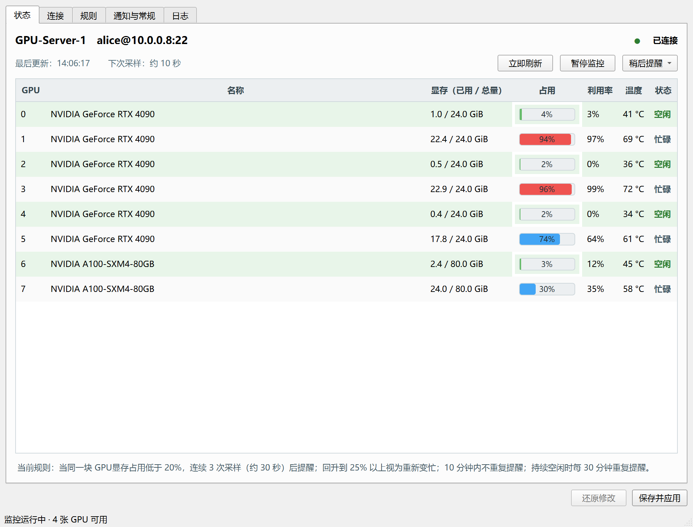
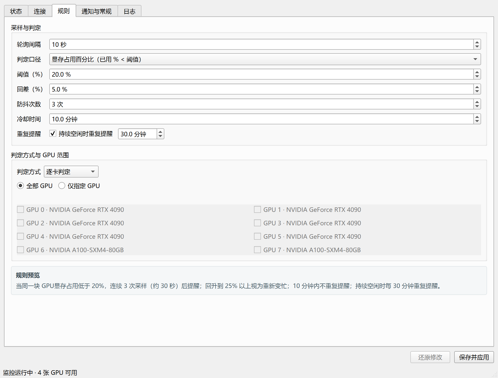
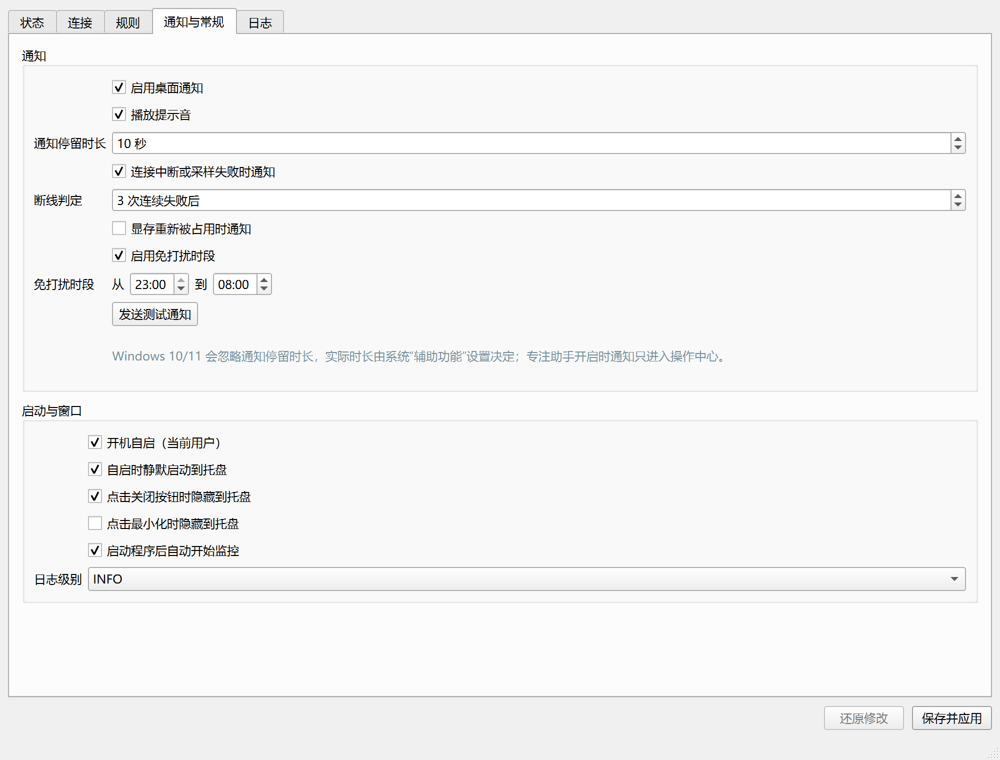

# GpuWatch

[English](README.md) | **简体中文**

[](#环境要求)
[](#开发)
[](LICENSE)
[](https://github.com/AIWfei/GpuWatch/stargazers)

GpuWatch 是一个常驻 Windows 托盘的桌面小工具：通过 SSH 监控远程 Linux 服务器上的 NVIDIA GPU 显存，在显卡空闲时提醒你。它专为共享 GPU 服务器设计，不必再反复登录服务器执行 `nvidia-smi` 查看有没有空卡。

- **服务器端零部署**——只需要 SSH 和 `nvidia-smi`。
- **托盘常驻**——关闭窗口后继续监控，可选开机自启与静默启动。
- **无遥测**——除连接你自己服务器的 SSH 会话外不发送任何数据；凭据保存在 Windows 凭据管理器。



> 界面目前为简体中文，截图使用演示数据。欢迎参与界面本地化。

## 功能

- **实时 GPU 状态页**——逐卡显示显存已用 / 总量、占用条、利用率、温度和空闲状态，按设定间隔刷新。
- **灵活的空闲规则**——支持已用百分比、已用 MiB、空闲 MiB 三种口径，以及回差、防抖、冷却和可选的重复提醒。
- **逐卡或整机判定**——可逐卡独立判定、任一 GPU 空闲时提醒，或全部 GPU 空闲时提醒；也可只监控指定 GPU。
- **安全的 SSH 接入**——支持密码或 OpenSSH / PEM 私钥（可带口令）、测试连接；首次连接强制核对 SHA-256 主机密钥指纹。
- **断线自愈**——复用一条 SSH 连接，断线后按 5 秒 → 5 分钟的指数退避重连；可选断线 / 恢复通知；认证失败或主机密钥变化时立即停止重试。
- **不打扰的提醒**——点击通知唤起主窗口、可选提示音、免打扰时段、稍后提醒（30 分钟 / 1 小时 / 2 小时）、关闭到托盘、开机自启、静默启动和单实例运行。
- **可运维**——日志滚动写入文件，界面内可查看和导出；支持 `Ctrl+S` 保存。

## 界面

<p align="center">
  
  
</p>

## 工作原理

```text
Windows 本机                             Linux GPU 服务器
GpuWatch（PySide6 + paramiko）  ──SSH──▶  nvidia-smi --query-gpu=...
界面 · 告警引擎 · 托盘                   无需安装代理、守护进程或 sudo
```

GpuWatch 保持一条 SSH 长连接，每次轮询执行一条只读查询：

```bash
LC_ALL=C timeout 15 nvidia-smi \
  --query-gpu=index,uuid,name,memory.used,memory.total,utilization.gpu,temperature.gpu \
  --format=csv,noheader,nounits
```

CSV 输出在本地解析，所有阈值与通知逻辑都在 Windows 侧运行。GPU 采集失败会在下一次轮询时重试，SSH 连接失败按指数退避重连（5 秒 → 5 分钟）；认证失败和主机密钥错误则立即停止监控。

## 环境要求

| | 要求 |
| --- | --- |
| 本机 | Windows 10/11 x64。 |
| 服务器 | 已安装 NVIDIA 驱动的 Linux，`nvidia-smi` 可执行；已在 Ubuntu 上验证。需要 coreutils 提供的 `timeout` 命令。 |
| 访问 | 本机能访问服务器 SSH 端口，并有一个可登录账户。支持密码或密钥认证；查询 `nvidia-smi` 不需要 root。 |
| 源码运行 | Python 3.11+ 和 [uv](https://docs.astral.sh/uv/)。 |
| 预编译版本 | 无需安装 Python。 |

非交互 SSH 会话的 `PATH` 可能与登录终端不同。如果终端里能运行 `nvidia-smi`，但 GpuWatch 报退出码 127，请在 **连接 → 高级** 中填写完整路径，例如 `/usr/bin/nvidia-smi`。

## 安装

### 方式一：下载预编译版本

从 [Releases](https://github.com/AIWfei/GpuWatch/releases) 下载最新的 Windows 压缩包，解压到任意目录并运行 `GpuWatch.exe`，无需安装 Python。如果暂时还没有可用版本，请使用下面的源码方式运行或自行打包。

### 方式二：从源码运行

```powershell
git clone https://github.com/AIWfei/GpuWatch.git
cd GpuWatch
uv sync
uv run python -m gpuwatch
```

`uv run python run.py` 效果相同。静默启动到托盘：

```powershell
uv run python -m gpuwatch --minimized
```

### 方式三：自行打包可执行文件

```powershell
uv sync
uv run pyinstaller --noconfirm --clean gpuwatch.spec
```

产物为 `dist/GpuWatch/GpuWatch.exe`（onedir，无控制台窗口）。将整个 `dist/GpuWatch/` 目录压缩后即可分发。详细说明见 [打包](#打包可执行文件)。

## 快速开始

1. **配置连接**——打开 **连接** 页，填写服务器名称、主机、SSH 端口、用户名和认证方式，点 **测试连接** 验证并列出检测到的 GPU。
2. **核对主机密钥**——首次连接会显示服务器的 SHA-256 指纹。在服务器上执行以下命令核对：
   ```bash
   ssh-keygen -lf /etc/ssh/ssh_host_ed25519_key.pub
   ```
   与弹窗中的指纹一致后选择 **信任并继续**。之后如果服务器密钥发生变化，GpuWatch 会停止监控而不是盲目连接。
3. **设置空闲规则**——在 **规则** 页选择判定口径、阈值、回差、防抖次数、冷却时间、GPU 范围和判定方式。底部的规则预览会用一句话说明当前设置的效果。
4. **配置通知**——在 **通知与常规** 页启用桌面通知和提示音，设置免打扰时段与断线通知，并决定是否开机自启、关闭窗口时是否隐藏到托盘。
5. **保存并应用**——点击 **保存并应用**（或按 `Ctrl+S`）。默认情况下关闭窗口会隐藏到托盘；托盘菜单可暂停 / 恢复监控、立即刷新、稍后提醒、发送测试通知或退出。

## 空闲判定

支持三种判定口径：

| 口径 | 触发提醒 | 视为重新变忙 |
| --- | --- | --- |
| 已用显存百分比 | 已用 % < 阈值 | 已用 % ≥ 阈值 + 回差 |
| 已用显存（MiB） | 已用 MiB < 阈值 | 已用 MiB ≥ 阈值 + 回差 |
| 空闲显存（MiB） | 空闲 MiB ≥ 阈值 | 空闲 MiB < 阈值 − 回差 |

- **回差**：避免数值在阈值附近反复抖动。
- **防抖**：连续 N 次采样都满足条件才提醒。
- **冷却**：显卡短暂离开又进入空闲状态时，避免连续重复提醒。
- **重复提醒**：显卡持续空闲时，按固定间隔再次提醒。
- **判定方式**：`逐卡判定` 对每张卡分别判定和提醒；`任一 GPU` 只要有一张被监控的卡空闲就提醒；`全部 GPU` 只有在所有被监控的卡都空闲时才提醒。
- **GPU 范围**：可监控全部 GPU，也可只勾选部分 GPU。

默认设置下：同一块 GPU 连续 3 次采样（10 秒间隔时约 30 秒）低于 20% 即提醒；回升到 25% 以上视为重新变忙。冷却时间为 10 分钟，默认不重复提醒。

## 安全与隐私

- 密码和私钥口令只保存在 **Windows 凭据管理器**（服务名 `GpuWatch`），不会写入 `config.json`，也不会出现在日志里。
- 严格校验主机密钥，从不使用 `AutoAddPolicy`。首次连接必须确认 SHA-256 指纹；指纹变化会立即停止监控。
- 认证失败后立即停止自动重试，避免连续失败触发 fail2ban 等封禁机制。
- 远程命令固定且只读；可配置的 `nvidia-smi` 路径经 `shlex.quote` 处理。
- 程序不发送任何遥测数据，也不访问第三方服务；唯一的网络连接是指向你自己服务器的 SSH 会话。
- 建议使用专用低权限账户和密钥认证。查询 `nvidia-smi` 本身不需要 `sudo`。

## 数据位置

| 内容 | 路径 |
| --- | --- |
| 配置 | `%APPDATA%\GpuWatch\config.json` |
| 已信任主机密钥 | `%APPDATA%\GpuWatch\known_hosts` |
| 日志 | `%APPDATA%\GpuWatch\logs\gpuwatch.log`（1 MB × 5 滚动） |
| 凭据 | Windows 凭据管理器，服务名 `GpuWatch`，账户名 `<server_id>:password` / `<server_id>:passphrase` |

配置文件损坏时会自动备份为 `config.json.bak` 并恢复默认设置。

## 常见问题

| 现象 | 原因 / 处理 |
| --- | --- |
| 提示找不到 `nvidia-smi`（退出码 127） | 非交互 SSH 会话的 `PATH` 不包含它。在 **连接 → 高级** 中填写完整路径，例如 `/usr/bin/nvidia-smi`。 |
| 提示无法与 NVIDIA 驱动通信 | 驱动未加载，或升级驱动后服务器未重启。请在服务器上排查驱动。 |
| 认证失败 | 用 `ssh` 命令确认同样的账号和认证方式能否登录；部分服务器禁止密码登录。 |
| 私钥无法读取 | PuTTY 的 `.ppk` 格式不被直接支持，请用 PuTTYgen 导出为 OpenSSH 格式。 |
| 通知不弹出 | 关闭专注助手 / 勿扰模式，检查 Windows 通知设置，并用 **发送测试通知** 排查。 |
| 开机自启不生效 | 可执行文件被移动或被安全软件拦截。在程序中重新勾选自启，并检查 **设置 → 应用 → 启动**。 |
| 连接频繁断开 | NAT 或防火墙可能回收空闲连接。GpuWatch 每 30 秒发送 SSH keepalive；若仍频繁断开，请检查 VPN 或网络链路。 |
| 重装服务器后提示主机密钥变化 | 服务器密钥确实变了。在服务器上核对新指纹后，用 **清除已信任指纹** 清除旧记录并重新连接。 |

## 开发

```powershell
git clone https://github.com/AIWfei/GpuWatch.git
cd GpuWatch
uv sync
uv run python -m gpuwatch
```

运行测试：

```powershell
uv run pytest
```

测试覆盖 `nvidia-smi` 输出解析、告警状态机、配置读写和 SSH 主机密钥处理，不需要 Qt 窗口、网络连接或 GPU。

更多实现细节见 [开发文档](GpuWatch%20%E5%BC%80%E5%8F%91%E6%96%87%E6%A1%A3.md)。

### 打包可执行文件

```powershell
uv sync
uv run pyinstaller --noconfirm --clean gpuwatch.spec
```

spec 文件已包含图标、`src` 路径和 keyring 的 Windows 后端隐藏导入。选择 `onedir` 是有意为之：启动更快，也比 `onefile` 更不容易被杀毒软件误报。建议在未安装 Python 的干净 Windows 机器上验收，包括托盘、通知、凭据管理器、开机自启和 SSH 连接。

## 项目结构

```text
src/gpuwatch/
  __main__.py       程序入口
  app.py            控制器：装配、生命周期、配置保存、托盘菜单
  config.py         配置数据类、校验、原子读写
  secrets_store.py  Windows 凭据管理器封装
  ssh_session.py    SSH 连接、主机密钥校验、重连退避
  gpu_probe.py      nvidia-smi 命令构造与 CSV 解析
  alert_engine.py   纯逻辑告警状态机
  worker.py         QThread 轮询循环与测试连接任务
  notifier.py       托盘通知、提示音、免打扰
  system.py         开机自启、单实例、资源路径
  logging_setup.py  滚动文件日志与界面日志处理器
  ui/               主窗口、各标签页、对话框
tests/              解析器、告警引擎、配置与 SSH 单元测试
assets/             应用图标
docs/screenshots/   README 截图
gpuwatch.spec       PyInstaller 打包配置
```

## 参与贡献

欢迎提交 Issue 和 Pull Request，请先阅读 [CONTRIBUTING.zh-CN.md](CONTRIBUTING.zh-CN.md)。界面本地化非常需要帮助。所有贡献均按 MIT 许可证授权。

## 许可证

[MIT](LICENSE) © 2026 AIWfei。GpuWatch 与 NVIDIA 无隶属关系，也未获得其背书。
